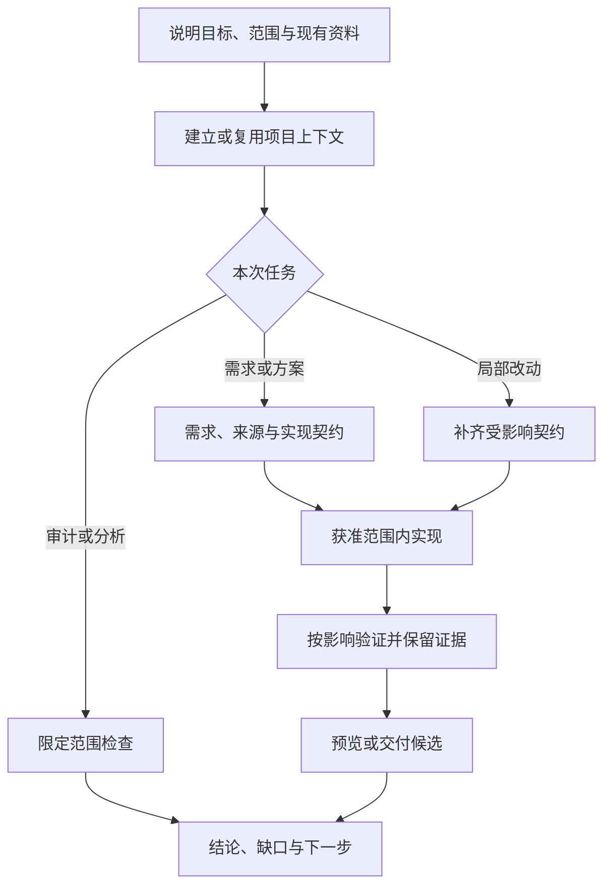

# DTC-skills

面向 DTC（Direct-to-Consumer，直接面向消费者）与 Web 项目的 AI 开发技能库。将需求、设计取证、组件实现、验证、交付和复盘整理为可按需组合的工作方法，帮助助手理解项目边界、形成可审阅产物，并准确说明做到了哪一步。

当前包含 **24 个技能**。核心流程不绑定某个品牌、框架或商店；Shopify、Figma、Nx、GTM/GA4 的具体规则放在相应技能的参考资料中，按目标项目实际能力使用。

## 从这里开始

| 你要做什么 | 阅读入口 |
| --- | --- |
| 第一次使用，了解如何下载、加载与配置 | [快速开始](docs/getting-started.md) |
| 根据任务选择技能，查看请求示例和交付步骤 | [场景工作流](docs/workflows.md) |
| 把技能接入自己的项目 | [目标项目档案](targets/README.md)与[可填写示例](targets/web-app.example.md) |
| 查看全部技能及其职责 | 下方技能目录，或[机器索引](skills/catalog.json) |
| 修改技能、添加场景或贡献文档 | [贡献与维护指南](CONTRIBUTING.md) |
| 检查公开内容与敏感信息 | [公开整理与维护](docs/publication.md) |
| 了解流程能力如何映射到公开版 | [流程覆盖清单](docs/workflow-coverage.md) |

## 适用场景与交付内容

适合需要 AI 参与实际工程的开发者、技术负责人和设计协作人员：从想法整理需求，根据设计稿或已有页面开发组件，修改既有功能，检查埋点分析链路，准备预览/交付，或复盘开发过程。

| 工作 | 可能得到的产物 |
| --- | --- |
| 需求与方案 | 范围、可观察验收标准、组件边界、方案比较、待决定项 |
| 设计到实现 | 来源证据、UI 参数与目标、组件代码、真实组件预览 |
| 测试与交付 | 受影响场景、视觉对照、构建候选、写入与回读记录、未验收项 |
| 分析与复盘 | 事件场景及指标口径、业务可用性发现、证据记录、流程改进建议 |

产物写入实际目标项目，复用已有需求与文档；只有通用技能、合成示例和仓库维护资料进入本仓库。小改动只补相关内容，不要求每次创建整套文档。

本仓库提供技能指令、参考资料、模板、仓库校验脚本，以及按需使用的 nb-project 收录客户端。AI 客户端、设计/浏览器工具、构建系统、平台账号及权限由使用环境提供；没有随包的自动调度器、部署器、主题合并引擎或分析平台配置执行器。

## 快速体验

```sh
git clone https://github.com/Lee-NG915/DTC-skills.git
cd DTC-skills
```

使用 PR 中的版本时，先按该 PR 的说明检出对应分支或提交；默认分支不一定包含未合并内容。记录所用版本，便于复现。

在能读取本地文件的 AI 助手中，提供 DTC-skills 的实际路径与目标项目位置，例如：

```text
请读取 <DTC_SKILLS_ROOT>/skills/dtc-context/SKILL.md。
目标是当前工作区中的 Web 项目。本次要给已有商品卡增加可选副标题，
保留原有价格和购买行为。请先检查相关实现、现有规范和目标档案，
说明最小影响范围，再按本次改动需要的技能完成实现与验证。
不要将缺失的项目命令、业务规则或平台状态写成已确认事实。
```

尖括号内容需要替换为实际信息。目标项目的配置与验证方法见[快速开始](docs/getting-started.md)。clone 不等于客户端已安装或发现技能，客户端的自动发现行为需单独核实。

## 使用流程



各阶段按任务进入，已有有效上下文和产物可以直接复用。只要方案就交方案；静态审计不自动实施；视觉修改不自动新增埋点。平台写入与发布沿用当前明确授权，不从历史项目、技能内容或配置存在推断权限。

详细组合、可复制请求和完成条件见[场景工作流](docs/workflows.md)。

## 技能目录

### 上下文、需求与方案

| 技能 | 使用时机 | 核心产物 |
| --- | --- | --- |
| [dtc-context](skills/dtc-context/SKILL.md) | 进入项目或恢复任务 | 范围、能力、有效决定与未知项 |
| [dtc-monorepo-workflow](skills/dtc-monorepo-workflow/SKILL.md) | 多应用、共享包、生成/导入和构建链 | 应用归属、隔离规则、实际工程命令 |
| [dtc-requirements-analysis](skills/dtc-requirements-analysis/SKILL.md) | 整理想法、业务规则或变更请求 | 需求记录、可观察验收与待确认项 |
| [dtc-design-evidence](skills/dtc-design-evidence/SKILL.md) | 读取 Figma、运行页面或旧组件 | 来源证据、素材边界、覆盖与缺口 |
| [dtc-page-decomposition](skills/dtc-page-decomposition/SKILL.md) | 页面涉及多个区域、状态或数据边界 | 页面组件树与区域职责 |
| [dtc-atomic-decomposition](skills/dtc-atomic-decomposition/SKILL.md) | 复杂组件需要明确复用与组合方式 | 原子/组合组件契约 |
| [dtc-technical-design](skills/dtc-technical-design/SKILL.md) | 比较配置、复用、扩展或新建方案 | 数据、配置、兼容与验证方案 |
| [dtc-ui-spec](skills/dtc-ui-spec/SKILL.md) | 首次 UI 实现或视觉目标变化前 | 原值、采用目标、规则与断言 |

### 实现、验证与优化

| 技能 | 使用时机 | 核心产物 |
| --- | --- | --- |
| [dtc-implementation](skills/dtc-implementation/SKILL.md) | 已明确目标下实现或修改 | 生产源码、资源、预览与实现说明 |
| [dtc-component-testing](skills/dtc-component-testing/SKILL.md) | 配置、交互、状态与实例隔离验证 | 场景、fixture、执行结果与缺口 |
| [dtc-visual-validation](skills/dtc-visual-validation/SKILL.md) | 核对实现画面与采用的设计目标 | 同条件对照、差异和验证范围 |
| [dtc-scoped-validation](skills/dtc-scoped-validation/SKILL.md) | 根据实际改动决定检查深度 | 受影响检查与证据有效性 |
| [dtc-web-interface-audit](skills/dtc-web-interface-audit/SKILL.md) | 对指定 Web 源码做静态 UI 审计 | 定位到行的发现与运行验证缺口 |
| [dtc-optimization](skills/dtc-optimization/SKILL.md) | 有可测量的问题和改进目标 | 前后测量、改进与回归结果 |

### 业务、分析与交付

| 技能 | 使用时机 | 核心产物 |
| --- | --- | --- |
| [dtc-data-tracking](skills/dtc-data-tracking/SKILL.md) | 事件/许可/映射变化或分析可行性检查 | 场景语义、分析覆盖和下游边界 |
| [dtc-operations-review](skills/dtc-operations-review/SKILL.md) | 检查交付物能否支持约定业务任务 | 口径、可用性和维护成本发现 |
| [dtc-delivery](skills/dtc-delivery/SKILL.md) | 准备候选或执行已授权交付 | 候选身份、差异计划、回读与交接 |
| [dtc-ci-monitor](skills/dtc-ci-monitor/SKILL.md) | 查询或有界跟进指定提交 CI | 对应提交/attempt 的实际状态 |
| [nb-project-upload](skills/nb-project-upload/SKILL.md) | 上传 GitHub 项目或整理多来源候选草稿 | 分类条目、预检、新增/草稿与回读回执 |

### 贯穿记录与公开分享

| 技能 | 使用时机 | 核心产物 |
| --- | --- | --- |
| [dtc-evidence-log](skills/dtc-evidence-log/SKILL.md) | 阶段变化、失败恢复和任务交接 | 一份持续维护的权威记录 |
| [dtc-exception-handling](skills/dtc-exception-handling/SKILL.md) | 目标、依赖、证据或远端状态异常 | 停止条件、恢复路径与剩余动作 |
| [dtc-workflow-review](skills/dtc-workflow-review/SKILL.md) | 交接后或明确要求流程复盘 | 执行/规则/需求问题分类与改进建议 |
| [dtc-privacy-redaction](skills/dtc-privacy-redaction/SKILL.md) | 内容公开或跨环境交接前 | 脱敏内容及处理边界 |
| [dtc-recording-analysis](skills/dtc-recording-analysis/SKILL.md) | 将已脱敏的开发证据变成分享内容 | 录屏结构、旁白与发布前检查 |

## 仓库结构与格式

```text
DTC-skills/
├── README.md                   # 项目总览与技能选择
├── CONTRIBUTING.md             # 新增、修改、校验与 PR 约定
├── LICENSE                     # MIT
├── .env.example                # 可选收录客户端配置，不自动加载
├── docs/
│   ├── getting-started.md       # 下载、加载、接入、首次任务与排障
│   ├── workflows.md             # 场景组合、请求示例与交付判断
│   ├── workflow-coverage.md     # 公开流程覆盖说明
│   ├── workflow-coverage.json   # 来源能力到公开技能的对应索引
│   └── publication.md           # 脱敏检查与公开维护边界
├── targets/
│   ├── README.md               # 目标项目档案契约
│   └── web-app.example.md      # 合成模板，真实档案留在目标项目
├── schemas/skill.schema.json   # 本仓库扩展元数据约束
├── scripts/                    # 结构校验、文本扫描及扫描器测试
├── .github/workflows/          # 本仓库 CI 检查
└── skills/
    ├── catalog.json            # 技能名称、阶段与入口索引
    └── <skill-name>/
        ├── SKILL.md             # name/description 与执行指令
        ├── skill.json           # 版本、输入输出、关联技能等扩展元数据
        ├── references/          # 按需读取的细则；并非每项都有
        ├── assets/              # 可使用的模板/合成示例；按需创建
        └── scripts/             # 只有确有执行能力时提供
```

标准入口为 `SKILL.md`，采用 [Agent Skills 格式](https://agentskills.io/specification) 的名称与描述。`skill.json` 是本仓库扩展，`inputs`/`outputs` 是自然语言交接约定；`relatedSkills` 表示按需协作关系，不是必跑依赖或自动调度图。`references` 的存在也不表示其中描述的执行器已经随包提供。

## 项目适配与能力边界

目标项目可以提供 `.dtc/target-profile.md`，也可显式声明其他路径。档案记录实际目录、技术栈、命令、资源/字体、预览和交付层级；具体契约见 [targets/README.md](targets/README.md)。没有档案仍可工作，未知能力通过调查补齐，不编造命令或默认店铺。

- 有 DOM/CSS 时使用对应布局与画面证据；原生平台采用等价视图/状态证据。概念映射不代表已经完成全部框架集成。
- 没有 Storybook 时使用已有预览方式；没有自动测试时保留可复现步骤和缺口。
- 设计事实、实现、测试、远端回读、业务验收与发布各有自己的证据，不能互相替代。
- 仓库目前提供工作流和本地检查，未对所有目标平台完成端到端验证。

## 校验与维护

使用技能指令本身不需要安装 Node 依赖。`nb-project-upload` 的上传脚本需 Python 3、目标站 origin 与专用收录凭证，见[使用入口](skills/nb-project-upload/SKILL.md)；其他工作流沿用目标工具的认证。运行本仓库检查需要 Ruby 与 Python 3；Git 用于版本和导出检查。

```sh
ruby scripts/validate.rb
python3 -m unittest discover -s scripts -p 'test_*.py'
python3 scripts/check_public.py
```

CI 执行同一组检查。它们验证技能结构、元数据、引用和部分泄露模式，不代替目标项目测试、真实平台验收或内容审查。新增技能、版本更新及验证结果的维护方法见 [CONTRIBUTING.md](CONTRIBUTING.md)。

## 许可与公开范围

本仓库采用 [MIT License](LICENSE)。示例与文档不包含真实商店、客户或内部业务资料；使用者的项目源码、设计素材和第三方内容仍按各自许可与权限处理。公开前执行[脱敏检查](docs/publication.md)，原始日志、真实档案、凭据和访问型链接留在受控环境。
